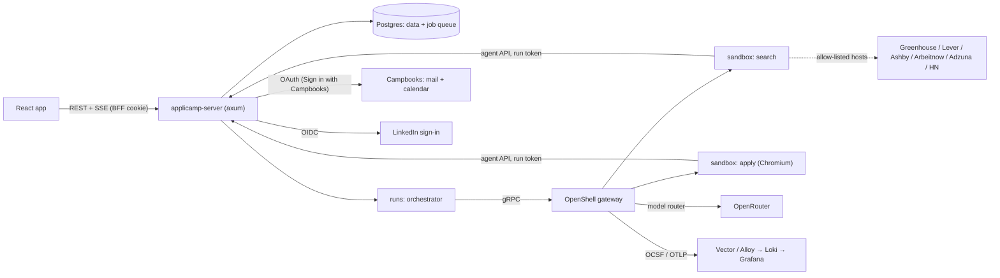

# Architecture

Applicamp is one Rust server, one React client, a Postgres database, and a
sandbox runtime where agents do their work. The server owns every piece of
your data and every action that leaves your name; agents can only ask it to
do things.

## Crates

| Crate | Role |
|---|---|
| `crates/kernel` | Config (figment, `_FILE` secrets), errors (problem+json), DB (sqlx), ids, clock, auth (session + scopes), job queue + scheduler (Postgres), domain events (outbox), telemetry, blobs. Trimmed copy of Campbooks Next's kernel. Knows no domain. |
| `crates/ai` | Model gateway by role over the OpenAI-compatible API (OpenRouter): `complete` for writing, `decide` for yes/no judgements. Usage ledger. |
| `crates/server` | Composes modules, serves the web client, BFF (session cookie, CSRF), OpenAPI. |
| `crates/agent` | The runner binary baked into sandbox images: talks to the agent API, drives Chromium over CDP in the browser image. |
| `crates/modules/identity` | Accounts, invite list, sign-in with Campbooks and LinkedIn (OIDC), sessions. |
| `crates/modules/profile` | Master profile (from LinkedIn export ZIP / PDF / pasted CV), goals and the first-run interview. |
| `crates/modules/sources` | Job-board readers and their terms (rate limits, attribution). |
| `crates/modules/pipeline` | Opportunities, stages, matches, notes, activity. |
| `crates/modules/cvs` | Master CV (JSON Resume–compatible), tailored variants, fact-check gate, Typst PDF rendering, ATS text check. |
| `crates/modules/runs` | Run lifecycle, sandbox orchestration, policies, run events (SSE), agent API. |
| `crates/modules/approvals` | Everything that waits on you, and executing it once accepted. |
| `crates/modules/correspondence` | Recruiter threads and drafts through the Campbooks API; calendar slots. |

## A run, end to end

1. A schedule or a click enqueues `runs.start` with the run kind and inputs.
2. The orchestrator asks the OpenShell gateway for a sandbox: the image for the
   kind, its committed policy (`policies/<kind>.yaml`), CPU/memory/time limits.
3. The agent starts with a run token and calls only its tools on the agent API
   (`read_profile`, `propose_opportunity`, `save_cv_variant`,
   `request_approval`, …). Model calls go through OpenShell's router, which
   adds the key outside the sandbox.
4. The agent writes structured JSON events to stdout. The orchestrator reads
   the sandbox log stream into `runs.run_events` and fans it out over SSE to
   the Agents page. OpenShell's allow/deny decisions are kept as raw log.
5. Outward steps become approvals. An application waits paused before Submit;
   accepting resumes the sandbox to submit, timing out hands you a prefilled
   link. Emails are drafts in Campbooks; accepting makes the server send.
6. The sandbox is deleted whatever happened.

## Clients

`clients/app` (Vite, React 19, TypeScript strict, TanStack Router + Query,
generated API types, zod, i18next with en / pt-PT / es-ES / fr, Vitest,
Playwright happy-path e2e). Components and tokens come from `@notacamp/ui`;
Applicamp's Notion-like look is its own token set.

## Infrastructure

Same as Campbooks: one image on GHCR (arm64 + amd64, Trivy), Docker Compose
deploys driven from the private ops repo, secrets from Infisical, Caddy in
front, Route53 DNS, restic backups, Vector → Loki, Prometheus, GlitchTip,
ntfy alerts. The OpenShell gateway and sandboxes run on their own arm64 box.
